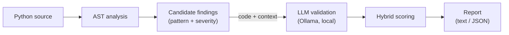

# ASTra - AST + LLM Security Auditor

[](https://github.com/Illera03/astra-ast-llm-security-auditor/actions/workflows/ci.yml)
[](https://www.python.org/downloads/)
[](LICENSE)

Hybrid security vulnerability scanner that combines Abstract Syntax Tree (AST) static analysis with LLM-based semantic reasoning to detect vulnerabilities in Python codebases.

> **A review aid, not a replacement.** ASTra can produce both false positives and
> false negatives. Use its output to support manual review, not as a substitute
> for it.

## Overview

ASTra uses a three-stage pipeline:

1. **AST Analysis** — Parses Python source code and detects vulnerability patterns via `ast.NodeVisitor`
2. **LLM Validation** — Sends suspicious code to a local LLM (Ollama) for semantic verification
3. **Hybrid Scoring** — Combines AST heuristics (40%), LLM confidence (40%), and code complexity (20%) with a 0.65 threshold (see [How Scoring Works](#how-scoring-works))



> **Privacy by design.** ASTra runs entirely on your machine: the code is sent
> only to a local Ollama instance and never leaves your environment. That makes
> it safe for auditing private, proprietary, or regulated code.

### Supported Vulnerabilities

| CWE | Name | Detected Patterns |
|---|---|---|
| CWE-78 | Command Injection | `subprocess.*`, `os.system`, `os.popen*`, `os.spawn*` |
| CWE-502 | Insecure Deserialization | `pickle.*`, `marshal.*`, `yaml.load`, `shelve.open`, `jsonpickle.*` |
| CWE-22 | Path Traversal | `open()`, `os.remove()`, `os.path.join()`, `pathlib.Path()` chains |

## Example

Given a small Python file, `example.py`:

```python
import pickle


def load_session(token: bytes) -> object:
    return pickle.loads(token)
```

Scan it — pick either setup; it is the same CLI over the same code:

```bash
# Docker (recommended)
docker compose run --rm astra example.py

# Local
poetry run python -m app.cli example.py
```

```
[*] Starting ASTra Security Scan on: example.py
[*] Phase 1: Static AST parsing...
[!] Found 1 potential vulnerabilities.
[*] Phase 2: Semantic analysis via LLM...

--- Analyzing CWE-502 at line 5 ---
[VULN] Confirmed Vulnerability! (Score: 0.8 >= 0.65)
       Path: The code uses 'pickle.loads' to deserialize a byte token, which is
       potentially untrusted. Since pickle allows arbitrary code execution during
       deserialization, this code is exploitable if the source of 'token' is untrusted.
```

Add `--format json` for a machine-readable report (`-o <file>` also writes it to disk):

```bash
docker compose run --rm astra example.py --format json
# or
poetry run python -m app.cli example.py --format json
```

```json
{
    "scanned_file": "example.py",
    "total_vulnerabilities_found": 1,
    "findings": [
        {
            "cwe_id": "CWE-502",
            "line_number": 5,
            "severity": "CRITICAL",
            "final_score": 0.8,
            "exploit_path": "The code uses 'pickle.loads' to deserialize a byte token, which is potentially untrusted. Since pickle allows arbitrary code execution during deserialization, this code is exploitable if the source of 'token' is untrusted.",
            "code_snippet": "def load_session(token: bytes) -> object:\n    return pickle.loads(token)"
        }
    ]
}
```

> In the JSON, `severity` (`CRITICAL`/`HIGH`/`MEDIUM`/`LOW`) is the **base level of
> the matched AST pattern**, not the result of the score — see
> [How Scoring Works](#how-scoring-works).
>
> Example output is model-dependent and **non-deterministic**: the same input can
> produce different wording *and a different score* between runs. Near the `0.65`
> threshold this can change the verdict (confirmed vs. filtered), so treat
> borderline scores with caution.

## Quick Start (Recommended: Docker)

The recommended way to run ASTra. It works on any OS, requires no local Python
or Ollama install, and uses the same environment everywhere.

**Prerequisite:** [Docker](https://docs.docker.com/get-docker/) with Compose.

```bash
# Build the scanner image
docker compose build

# Start Ollama and download the model into a persistent volume (first run only, ~4.7 GB)
docker compose run --rm model-setup

# Scan a file (paths are relative to the repository, mounted at /workspace)
docker compose run --rm astra demo.py

# JSON report
docker compose run --rm astra demo.py --format json -o report.json
```

Notes:

- `model-setup` and `astra` start Ollama automatically (`depends_on`), so there is
  no need to run `docker compose up` first.
- The model is stored in the `ollama_data` volume and downloaded only once. Stop
  the stack with `docker compose down`; add `-v` to also delete the model.
- To use a different model, set `ASTRA_MODEL` for **both** commands so the pulled
  model matches the one the scanner requests:

  ```bash
  ASTRA_MODEL=qwen2.5-coder:1.5b docker compose run --rm model-setup
  ASTRA_MODEL=qwen2.5-coder:1.5b docker compose run --rm astra demo.py
  ```

- Ollama runs on CPU by default. To use an NVIDIA GPU on Linux, uncomment the
  `deploy` block in `docker-compose.yml` and install `nvidia-container-toolkit`.

## Local Installation (without Docker)

### Requirements

- **Python 3.11+**
- **Ollama** with `qwen2.5-coder:7b` (or `1.5b` for faster, less accurate scans)

### Setup

```bash
# Automated setup (macOS/Linux only)
./scripts/setup.sh

# Manual setup (any OS)
poetry install
cp .env.example .env
ollama pull qwen2.5-coder:7b
```

### Usage

```bash
# Scan a file
poetry run python -m app.cli demo.py

# Run the test suite
poetry run pytest tests/unit/ -v
```

The scan has a Docker equivalent — see [Quick Start](#quick-start-recommended-docker)
(`docker compose run --rm astra demo.py`). The test suite runs locally only, since
the image ships without the `dev` group.

## Configuration

Configuration applies to both the Docker and local setups.

### Model selection

Default model: `qwen2.5-coder:7b`.

| Setup | How to change the model |
|---|---|
| Docker | Set the `ASTRA_MODEL` environment variable for `model-setup` and `astra` |
| Local | Set `MODEL_NAME` in `.env`, then run `ollama pull <model-name>` |

> Inside Docker, configuration comes from environment variables in
> `docker-compose.yml`, not from `.env`.

### Environment variables

| Variable | Default | Description |
|---|---|---|
| `OLLAMA_HOST` | `http://localhost:11434` | Ollama endpoint (`http://ollama:11434` inside Docker) |
| `MODEL_NAME` | `qwen2.5-coder:7b` | Model used for semantic validation |
| `LOG_LEVEL` | `INFO` | Logging verbosity |
| `LANGFUSE_ENABLED` | `false` | Enable Langfuse tracing |

## How Scoring Works

An AST hit is only a *candidate*: the LLM validates it, and a hybrid score decides
whether it is a real finding.

```
final = 0.4 × heuristic + 0.4 × llm_risk + 0.2 × complexity
```

- **Heuristic (40%)** — fixed score of the matched AST pattern, mapped from
  severity: `CRITICAL=1.0`, `HIGH=0.8`, `MEDIUM=0.5`, `LOW=0.3`
  (`app/ingestion/parser.py`).
- **LLM risk (40%)** — the model's semantic verdict. For a call it deems
  exploitable it is the model's confidence; otherwise `1 − confidence`
  (`app/llm/client.py`).
- **Context complexity (20%)** — cyclomatic complexity of the file:
  `min(1.0, 0.2 + 0.1 × decision_points)`, where decision points count
  `if` / `for` / `while` / `except` / boolean operators (`app/ingestion/parser.py`).

A finding is **confirmed** (i.e. listed in the report) when `final ≥ 0.65`; below
that it is treated as a likely false positive and filtered out. Only confirmed
findings appear in the output, and each one carries its `final_score` plus the
matched pattern's base `severity`.

Because the LLM is non-deterministic, the same input can yield a different `final`
score on a fresh run. The exact code context is cached by SHA-256 in
`.astra_cache.db`, so repeated scans of identical code stay consistent until the
cache is cleared. Close to `0.65`, that variance can flip a finding between
confirmed and filtered.

The weights (`0.4 / 0.4 / 0.2`) and the `0.65` threshold are fixed constants in
`app/core/scoring.py`. They were chosen empirically for this project's target
scope and are **not yet configurable** via environment variables.

## Benchmark Results

Evaluated on 160 files (150 synthetic + 10 from [Bandit's test suite](https://github.com/PyCQA/bandit/tree/main/examples)) using `qwen2.5-coder:7b`:

| Tool | Precision | Recall | F1-Score |
|---|---|---|---|
| **ASTra** | **0.84** | **0.72** | **0.78** |
| Bandit | 0.86 | 0.59 | 0.70 |
| Semgrep | 0.86 | 0.49 | 0.62 |

**Per CWE:**

| CWE | ASTra F1 | Bandit F1 | Semgrep F1 |
|---|---|---|---|
| CWE-22 (Path Traversal) | **0.72** | 0.07 | 0.07 |
| CWE-502 (Deserialization) | **0.81** | 0.81 | 0.79 |
| CWE-78 (Command Injection) | 0.79 | **0.85** | 0.68 |

> **Note on dataset bias:** 150 of the 160 test files are synthetic (created for this project). The 10 Bandit examples provide an external, neutral reference. The synthetic dataset was designed around ASTra's detection capabilities, which favors ASTra in CWE-22 (where Bandit/Semgrep lack rules for Python's `open()` patterns). Results should be interpreted as performance within ASTra's target scope, not as a general SAST tool comparison.

### Reproducing the benchmark

```bash
# Evaluate ASTra against Bandit and Semgrep over the dataset manifest
poetry run python -m benchmarks --manifest datasets/manifest.yaml --format table

# Other options
poetry run python -m benchmarks --concurrency 1        # limit concurrent LLM calls
poetry run python -m benchmarks --tools astra,semgrep  # subset of tools
poetry run python -m benchmarks --format table,csv,json
```

Reports are written to `benchmarks/results/` (override with `--output-dir`). The
default manifest, `datasets/manifest.yaml`, ships in the repo. Run this locally:
Bandit and Semgrep come from the `dev` group and are **not** in the Docker image,
so the comparison tools are unavailable inside the container.

## Tech Stack

- **ast (stdlib)** — AST parsing and vulnerability pattern detection
- **Ollama** — Local LLM inference (`qwen2.5-coder:7b`)
- **Pydantic** — Data validation and schema enforcement
- **FastAPI** — HTTP API layer *(planned — not implemented yet; the current interface is the CLI)*
- **structlog** — Structured logging
- **Poetry** — Dependency management
- **Docker** — Containerized scanner + Ollama stack

## Known Limitations

- **No import alias resolution**: `from pickle import loads as foo; foo(data)` is not detected
- **Single-function scope**: Taint analysis does not cross function boundaries
- **3 CWEs only**: Does not cover SQL injection, XSS, SSRF, etc.
- **Local LLM latency**: ~7 min for 160 files with `qwen2.5-coder:7b` on CPU

## Roadmap

### Symbol Tracking (Import Alias Resolution)

The parser currently matches calls by module name (`pickle.loads`). Aliased imports like `from os import system as run_cmd` bypass detection entirely. A symbol table built during `visit_Import`/`visit_ImportFrom` would resolve aliases to their original module.function, closing the detection gap with Bandit on CWE-78.

### Intra-procedural Taint Analysis

Currently, the AST checks if a function argument is a variable (`ast.Name`) and flags it as dynamic. A lightweight taint tracker would trace variable definitions within the same function to determine if the source is user-controlled or a constant, reducing false positives and unnecessary LLM calls.

### Dynamic Rule Engine

Each new CWE requires a new `_check_*` method in the parser. A configuration-driven rule engine (YAML/JSON pattern definitions) would decouple detection logic from code, enabling new CWE coverage without modifying the parser.

### Multi-function Context

Real vulnerabilities often span multiple functions. Expanding the context window sent to the LLM to include caller/callee chains would leverage the model's semantic capabilities beyond single-function analysis.

## Troubleshooting

### Docker

- **Port `11434` already in use** — a local Ollama instance is likely running. Stop
  it, or remove the `ports` mapping in `docker-compose.yml` (the scanner reaches
  Ollama over the internal network and does not need the published port).
- **Model not found** — run `docker compose run --rm model-setup` with the same
  `ASTRA_MODEL` value used for `astra`.

### Local

- **Ollama connection error** — ensure Ollama is running (`ollama serve`) and that
  `OLLAMA_HOST` in `.env` matches your instance.
- **Model not found** — pull it with `ollama pull qwen2.5-coder:7b` and verify with
  `ollama list`.

### Benchmark timeout errors

- Reduce concurrency: `--concurrency 1`
- The default timeout is 120s per LLM call

## Contributing

1. Create a feature branch: `git checkout -b feature/your-feature`
2. Make changes and run checks: `./scripts/check.sh`
3. Commit with conventional commits: `feat:`, `fix:`, `refactor:`, etc.
4. Push and open a PR to `dev` branch

## License

Released under the **MIT License** — see the [LICENSE](LICENSE) file.

Copyright (c) 2026 Jorge.
